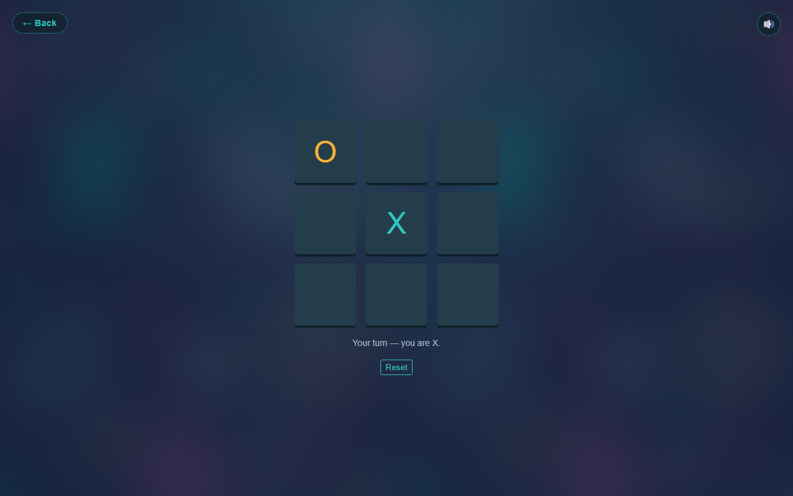
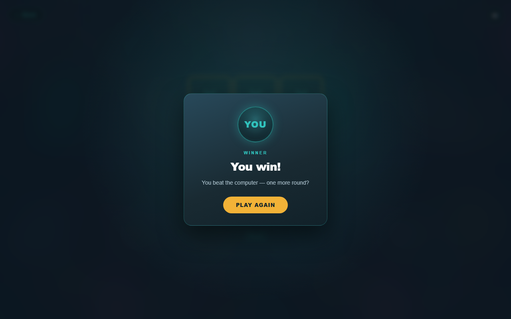
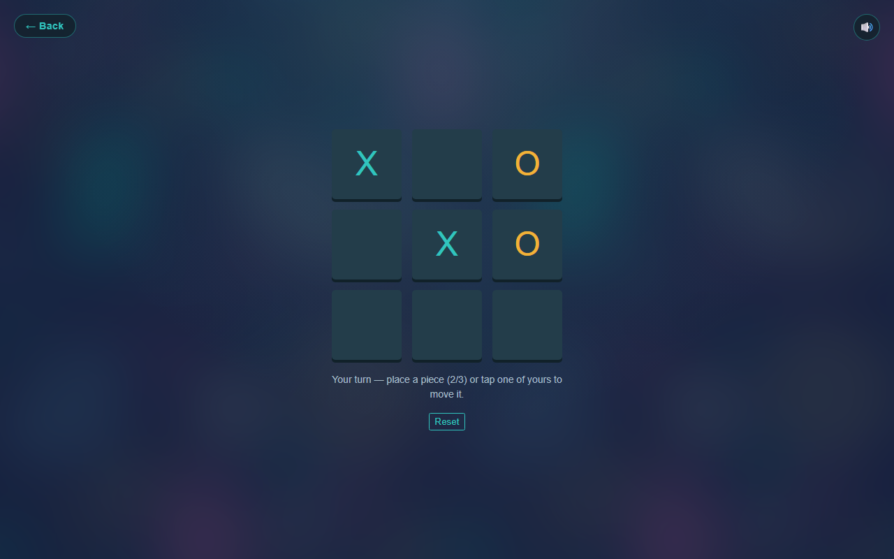

<h1 align="center">
  <br />
  IS Games
</h1>

<p align="center">
  Two board games for two players on one screen.<br />
  No install, no build step, no dependencies.
</p>


## Games

| Game | Rules | Win condition | Computer |
| --- | --- | --- | --- |
| **X & O** | Classic tic-tac-toe. Unlimited pieces, one mark per turn, pieces can never be moved. | A full row, column or diagonal. A full board with no line is a draw. | Yes |
| **Sega** | Each player has at most **3 pieces**. On your turn you either place a new piece or move one of your own to an empty cell. | A full **row or column** only. Diagonals do not count. | Yes |

Picking a game opens a mode screen: play with a friend on the same device, or against the computer.

<p align="center">
  
  
</p>


## Playing the computer

Both games have a computer opponent. You are always **X** and you move first; the
computer answers with **O**. The result card names the sides — **You** or **CPU** —
instead of showing X and O.

### X & O

The computer rates every empty cell by the chance that it leads to a win. It looks at
the eight winning lines: a line blocked by you is worth nothing, one of its pieces
makes a live line (1 point), two pieces mean one move from a win (12), three is a win
(1000). The same sum is computed for you as if you took that cell, and the move's score
is `attack - 0.9 × defence`:

- **Forks** — two open threats at once — outweigh any single line, so it takes them and
  tries not to hand you one.
- A **win** on the board is always taken.
- About **one move in three** it stops paying attention and plays somewhere else instead
  of blocking you — that is the gap you play for.
- On a tie it prefers the centre, then the corners.

There are two levels: `normal`, which the game uses, and `hard`, which is the same
engine with the slip turned off. `node XandO/ai.test.js` checks both — `hard` is played
against every possible line and never loses (it draws against perfect play), while
`normal` is played against an ordinary player and has to be beatable.

<p align="center">
  
  
</p>

### Sega

Sega pieces move, so the computer rates **moves** rather than cells. For every placement
or relocation it looks at the board that move would leave behind, scores it on the six
winning lines (rows and columns, never diagonals) with the same 1 / 12 / 1000 weights,
and picks the best one. It takes every win it can see, and it blocks the line you are
about to complete.

The `normal` level the game uses has a weak sense of defence and misses roughly one
block in three, so a player who watches the board can beat it. `hard` is the careful
version: it defends fully, hunts for forks and looks at your best answer before it
chooses. Neither level shuffles: a piece it has just moved will not be sent straight
back, and it never plays the same move twice in a row (the only exception is when that
move is the sole way to stop your line). `node sega/ai.test.js` plays whole rounds
against an ordinary player — every move has to be legal, `hard` must not lose, `normal`
has to stay beatable, and no round may contain a repeated or undone move.

<p align="center">
  
  
</p>

## Features

- **Two rule sets, two clean scripts** - `XandO/xando.js` and `sega/sega.js` are independent, so neither game is cluttered with branches for the other.
- **Mode screen** - one shared `mode.html?game=xando|sega` picks up the game you chose on the home screen, so both games get the same "friend or computer" step without duplicated markup. The computer card is live for both games.
- **Computer opponent (X & O)** - `XandO/ai.js` scores every empty cell with a probability model, then plays the best one. The default level still slips up now and then, so a round is winnable.
- **Computer opponent (Sega)** - `sega/ai.js` rates placements and relocations the same way, using rows and columns only. Its default level is deliberately forgiving.
- **One reply rhythm** - the computer answers after a 420–680 ms "thinking" pause in both games, and the board ignores clicks until its move lands.
- **Shared look** - one `game.css` for both boards, with the same artwork and palette as the home screen.
- **Animated result modal** - the winning line glows first, then a card pops in for a win or a draw. Close it with the button, the backdrop or <kbd>Esc</kbd>, and the board resets.
- **Sound effects** - placement, pick-up, illegal move, win and draw are synthesised with the Web Audio API at runtime, so the repo ships no audio files. The 🔊 button mutes everything and remembers the choice.
- **Responsive** - the board fills the width of a phone with 12px side margins, stays centred on tall screens, and fits short landscape screens without clipping.
- **Keyboard friendly** - cells are focusable and respond to <kbd>Enter</kbd> / <kbd>Space</kbd>.
- **Icon set** - SVG, multi-size ICO and an Apple touch icon, all generated from the same geometry.

## Run it

Open `index.html` in a browser. That is enough.

If you prefer a local server (recommended when testing layout in iframes):

```bash
python -m http.server 8765
# then open http://127.0.0.1:8765/
```

## Project structure

```
is-games/
├── index.html            # home screen with the two game cards
├── style.css             # home screen styles
├── mode.html             # "friend or computer" screen (shared by both games)
├── mode.css              # mode screen styles
├── game.css              # shared styles for both boards
├── sounds.js             # Web Audio sound effects + mute button
├── favicon.svg           # scalable app icon
├── favicon.ico           # 16 / 32 / 48 / 64 in one file
├── apple-touch-icon.png  # 180x180 icon for iOS
├── pattern.jpg           # background artwork
├── docs/                 # screenshots used in this README
├── sega/
│   ├── index.html
│   ├── ai.js             # move-based model for the computer opponent
│   ├── ai.test.js        # checks strength and legality (node sega/ai.test.js)
│   └── sega.js           # place / move / 3-piece limit, friend / computer turns
└── XandO/
    ├── index.html
    ├── ai.js             # probability model for the computer opponent
    ├── ai.test.js        # checks that it never loses (node XandO/ai.test.js)
    └── xando.js          # placement, draw detection, friend / computer turns
```

## How it is built

Plain HTML, CSS and JavaScript. No frameworks, no bundler, no npm install.

- Colors and radii live in CSS custom properties.
- The board is a CSS grid sized by `--grid-rows`, so it could grow past 3×3.
- The computer opponent lives in its own file (`XandO/ai.js`) and knows nothing about the DOM: `chooseMove(cells, me, them, level)` takes a flat 9-cell board and returns an index, which is what makes `ai.test.js` possible.
- Sega's engine (`sega/ai.js`) follows the same idea but returns a move: `{ type: "place", to }` or `{ type: "move", from, to }`, because a piece can be relocated. That is what lets `sega/ai.test.js` play whole rounds without a browser.
- The computer's move is delayed by 420–680 ms so the reply feels deliberate, and the board ignores clicks until it lands.
- Sounds are short oscillator envelopes scheduled on a lazily created `AudioContext` (browsers require a user gesture first).
- The mute preference is stored in `localStorage`.

### Browser support

Any current Chrome, Edge, Firefox or Safari. The code uses optional chaining and `??`, so very old browsers are not supported.

## بالعربي

**IS Games** موقع بسيط فيه لعبتين للعب على شاشة واحدة:

- **X & O**: تكتيك كلاسيكي - قطع غير محدودة، بدون تحريك، والفوز بصف أو عمود أو قطر.
- **Sega**: كل لاعب عنده **3 قطع** بس، وبيحرّك قطعة من قطعه بدل ما يحط واحدة جديدة، والفوز بصف أو عمود فقط (بدون أقطار).

الموقع شغّال من غير أي تثبيت: افتح `index.html` وابدأ اللعب. فيه مؤثرات صوتية متولّدة في المتصفح (وزرار كتم)، ومودال متحرك للفوز والتعادل، وتصميم متجاوب للموبايل والشاشات الكبيرة.

بعد اختيار اللعبة بتظهر شاشة اختيار الوضع: **اللعب مع صاحبك** على نفس الجهاز، أو **اللعب مع الكمبيوتر**.

لعبة **X & O** بقى فيها خصم كمبيوتر شغّال: انت دايمًا **X** وبتبدأ، والكمبيوتر بيلعب **O**. الكمبيوتر بيحسب لكل خانة فاضية احتمال إنها توصّله لخط فوز (الخط المفتوح = نقطة، نص الخط = 12، الخط الكامل = فوز)، وبيخصم منها احتمال إن الخانة تفيدك انت كمان. بياخد أي فوز شايفه، بس في **حوالي حركة من كل 3** بيسرح ويلعب حاجة تانية بدل ما يسدّ عليك — ودي الفرصة اللي تكسب منها. فيه كمان مستوى **hard** مش بيغلط خالص ومستحيل تكسبه. لما الجولة تخلص، البطل بيتعرض باسمه: **You** أو **CPU** بدل X و O.

ولعبة **Sega** كمان بقى فيها كمبيوتر. لأن القطع بتتحرك، الكمبيوتر بيقيّم **الحركة** نفسها مش الخانة: بيجرب كل وضع جديد أو نقل لقطعة من قطعه، ويبص على البورد اللي هيسيبه الحركة دي، وبيحسبه على 6 خطوط الفوز (صفوف وأعمدة بس، مفيش أقطار) بنفس الأوزان 1 / 12 / 1000. بياخد أي فوز شايفه، وبيسد الخط اللي انت على وشك تكمله. المستوى العادي بيغلط في السد في حوالي **حركة من كل 3**، فتقدر تكسبه؛ وفيه مستوى **hard** بيدافع كويس وبيخطط للشوكتين وبيفكر في ردك قبل ما يلعب. ومش بيرجّع القطعة اللي حرّكها فورًا لورا، ولا بيكرر نفس الحركة مرتين ورا بعض (إلا لو دي كانت الطريقة الوحيدة عشان يسد خطك).

تأكد بنفسك: `node XandO/ai.test.js` — بيختبر إن مستوى **hard** مش بيخسر ولا مرة، وإن المستوى العادي **ممكن تكسبه**. و`node sega/ai.test.js` بيلعب جولات كاملة ويختبر إن كل حركة قانونية، وإن **hard** مش بيخسر، وإن العادي **ممكن تكسبه**.
