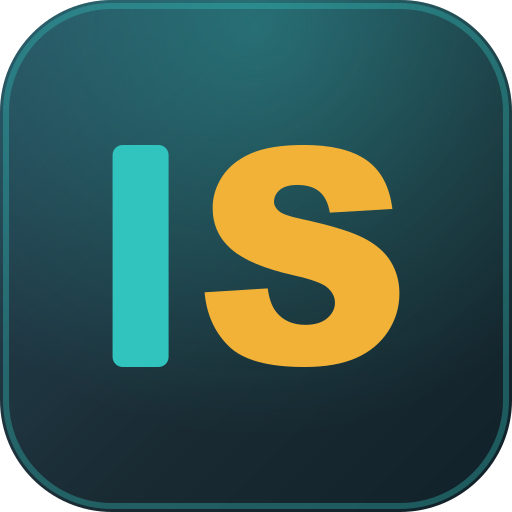
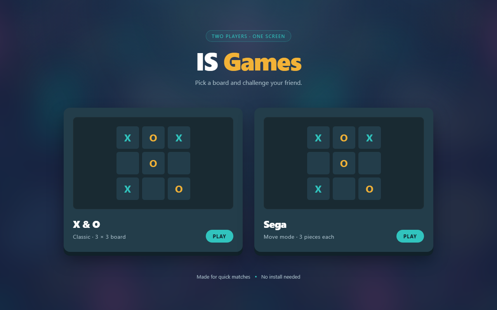
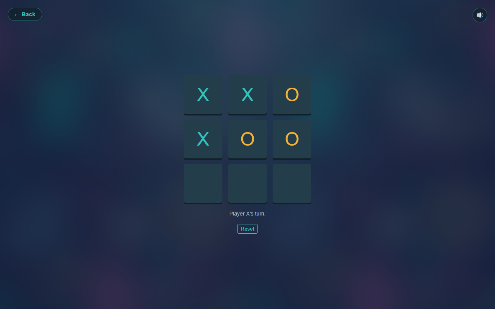
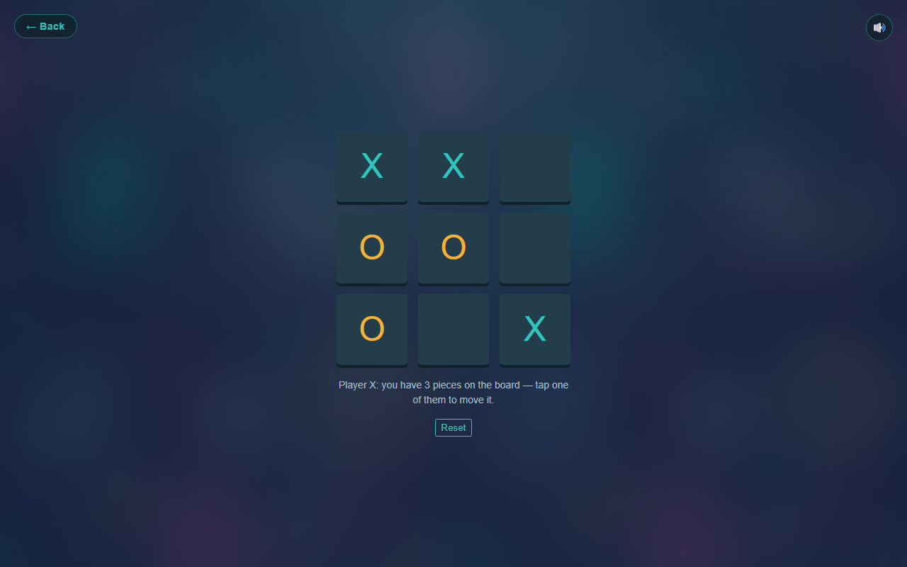
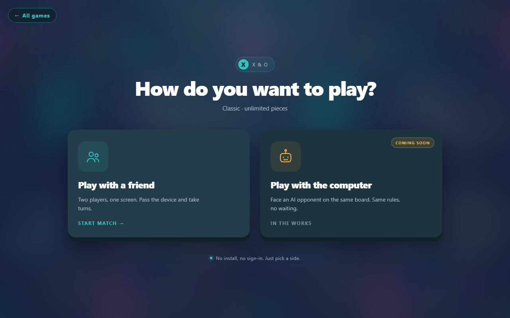

<h1 align="center">
  <br />
  IS Games
</h1>

<p align="center">
  Two board games for two players on one screen.<br />
  No install, no build step, no dependencies.
</p>



## Games

| Game | Rules | Win condition |
| --- | --- | --- |
| **X & O** | Classic tic-tac-toe. Unlimited pieces, one mark per turn, pieces can never be moved. | A full row, column or diagonal. A full board with no line is a draw. |
| **Sega** | Each player has at most **3 pieces**. On your turn you either place a new piece or move one of your own to an empty cell. | A full **row or column** only. Diagonals do not count. |

Picking a game opens a mode screen: play with a friend on the same device, or against the computer (coming soon).

<p align="center">
  
  
</p>



## Features

- **Two rule sets, two clean scripts** - `XandO/xando.js` and `sega/sega.js` are independent, so neither game is cluttered with branches for the other.
- **Mode screen** - one shared `mode.html?game=xando|sega` picks up the game you chose on the home screen, so both games get the same "friend or computer" step without duplicated markup. The computer card is a design placeholder for now.
- **Shared look** - one `game.css` for both boards, with the same artwork and palette as the home screen.
- **Animated result modal** - the winning line glows first, then a card pops in for a win or a draw. Close it with the button, the backdrop or <kbd>Esc</kbd>, and the board resets.
- **Sound effects** - placement, pick-up, illegal move, win and draw are synthesised with the Web Audio API at runtime, so the repo ships no audio files. The 🔊 button mutes everything and remembers the choice.
- **Responsive** - the board fills the width of a phone with 12px side margins, stays centred on tall screens, and fits short landscape screens without clipping.
- **Keyboard friendly** - cells are focusable and respond to <kbd>Enter</kbd> / <kbd>Space</kbd>.
- **Icon set** - SVG, multi-size ICO and an Apple touch icon, all generated from the same geometry.

## Run it

Open `index.html` in a browser. That is enough.

If you prefer a local server (recommended when testing layout in iframes):

```bash
python -m http.server 8765
# then open http://127.0.0.1:8765/
```

## Project structure

```
is-games/
├── index.html            # home screen with the two game cards
├── style.css             # home screen styles
├── mode.html             # "friend or computer" screen (shared by both games)
├── mode.css              # mode screen styles
├── game.css              # shared styles for both boards
├── sounds.js             # Web Audio sound effects + mute button
├── favicon.svg           # scalable app icon
├── favicon.ico           # 16 / 32 / 48 / 64 in one file
├── apple-touch-icon.png  # 180x180 icon for iOS
├── pattern.jpg           # background artwork
├── docs/                 # screenshots used in this README
├── sega/
│   ├── index.html
│   └── sega.js           # place / move / 3-piece limit
└── XandO/
    ├── index.html
    └── xando.js          # classic placement / draw detection
```

## How it is built

Plain HTML, CSS and JavaScript. No frameworks, no bundler, no npm install.

- Colors and radii live in CSS custom properties.
- The board is a CSS grid sized by `--grid-rows`, so it could grow past 3×3.
- Sounds are short oscillator envelopes scheduled on a lazily created `AudioContext` (browsers require a user gesture first).
- The mute preference is stored in `localStorage`.

### Browser support

Any current Chrome, Edge, Firefox or Safari. The code uses optional chaining and `??`, so very old browsers are not supported.

## بالعربي

**IS Games** موقع بسيط فيه لعبتين للعب على شاشة واحدة:

- **X & O**: تكتيك كلاسيكي - قطع غير محدودة، بدون تحريك، والفوز بصف أو عمود أو قطر.
- **Sega**: كل لاعب عنده **3 قطع** بس، وبيحرّك قطعة من قطعه بدل ما يحط واحدة جديدة، والفوز بصف أو عمود فقط (بدون أقطار).

الموقع شغّال من غير أي تثبيت: افتح `index.html` وابدأ اللعب. فيه مؤثرات صوتية متولّدة في المتصفح (وزرار كتم)، ومودال متحرك للفوز والتعادل، وتصميم متجاوب للموبايل والشاشات الكبيرة.

بعد اختيار اللعبة بتظهر شاشة اختيار الوضع: **اللعب مع صاحبك** على نفس الجهاز، أو **اللعب مع الكمبيوتر** (تصميم مبدئي لسه من غير منطق).
